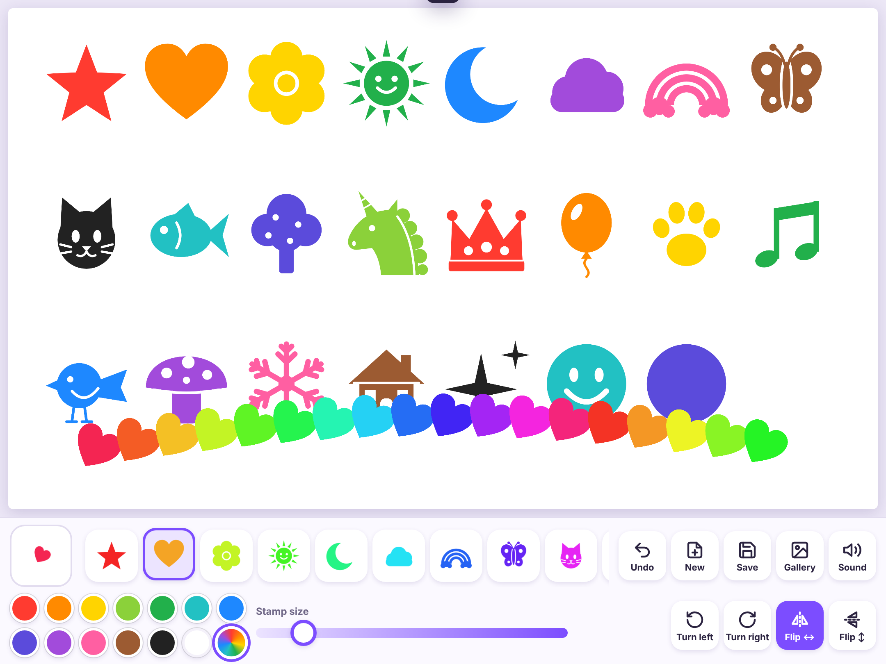

# Stamp Studio 🌟

A stamp drawing app for kids, made for the iPad. Pick a stamp, pick a color, and tap the page.



## What it does

- **23 built-in stamps**: star, heart, flower, sun, moon, cloud, rainbow, butterfly, cat, fish, tree, unicorn, crown, balloon, paw, music, bird, mushroom, snowflake, house, sparkle, smiley and dot.
- **13 colors plus a 🌈 rainbow** option that changes color with every stamp.
- **Turn, flip and resize** stamps before you place them. Tap the big preview box to straighten a stamp again.
- **Tap to stamp, or drag to make a trail.** Stamps stay locked in place once they're down.
- **Undo** the last 60 taps or drags.
- **Make your own stamps** with the **Make** button at the end of the stamp row:
  - *Draw it*: draw in black on a grid. *Mirror* mode makes both sides match.
  - *From a picture*: use a photo or picture. A marker drawing on paper works well. Choose **Stamp shape** to print it in any color, or **Keep colors** to use it like a sticker.
  - *My stamps*: delete stamps you don't want anymore.
- **Save** keeps the picture in the **Gallery**. From the Gallery you can open a picture to keep working on it, or tap **Photos** and then *Save Image* to put it in the iPad's Photos app.
- The current picture is saved automatically, so nothing is lost if the app is closed.
- A stamping sound plays with each stamp, and it can be turned off.
- It works offline once it has been opened.

Everything is stored on the device. Nothing is uploaded anywhere.

## Running it

It's a plain web page with no build step. To try it on a computer:

```sh
python3 -m http.server 8000
# then open http://localhost:8000
```

## Putting it on the iPad

1. Host the folder somewhere with `https`. GitHub Pages is the easiest: in the repository on GitHub, go to **Settings → Pages**, choose **Deploy from a branch**, pick the branch and `/ (root)`, then save. After a minute you get a link like `https://<user>.github.io/StampTestApp/`.
2. Open that link in **Safari** on the iPad.
3. Tap the **Share** button, then **Add to Home Screen**. The app now opens full screen from its own icon.

## How the code is organized

| File | What's in it |
| --- | --- |
| `index.html` | The page layout: toolbar and pop-up windows |
| `css/style.css` | All the styling |
| `js/app.js` | The main app: stamping, toolbar, undo, saving, gallery |
| `js/stamps.js` | The built-in stamp shapes. Add new ones here. |
| `js/maker.js` | The "Make a Stamp" window |
| `js/db.js` | Storage on the device (IndexedDB) |
| `js/ui.js` | Icons, pop-ups and other small helpers |
| `sw.js`, `manifest.webmanifest` | Offline support and the home screen app |
